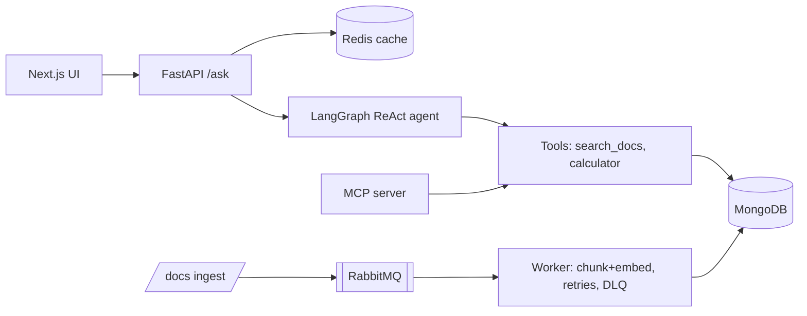

# AgentOps MCP

[](https://github.com/naveecode/agentops-mcp/actions)

A deployable AI agent service. A LangGraph ReAct agent with function calling answers questions over your documents and calls tools. The same tools are also exposed as an **MCP server**, so Cursor and Claude Desktop can use them. It ships as a FastAPI API with a Redis cache, Docker and CI.

## Problem
Teams want one agent that can answer from internal docs, run tools, and be reached two ways: over a REST API, and from AI IDEs over MCP. It should also be cached, testable and deployable.

## Architecture

Already built: API, agent, tools, Redis cache, MCP server, Docker and CI. Not built yet: the UI, RabbitMQ and MongoDB (see the roadmap).

## Quickstart
```bash
pip install -r requirements.txt
uvicorn app.main:app --reload          # http://localhost:8000/docs
docker compose up                      # API + Redis
pytest -q                              # offline tests
python -m app.mcp_server               # MCP (stdio) for Cursor/Claude
```
Set `OPENAI_API_KEY` (and optionally `MODEL`) to use the LLM agent. Without a key, a deterministic router picks the tool, so tests and demos run offline.

```bash
curl -XPOST localhost:8000/docs -H 'content-type: application/json' -d '{"id":"d1","text":"refund policy is 30 days"}'
curl -XPOST localhost:8000/ask  -H 'content-type: application/json' -d '{"question":"refund policy"}'
```

## Roadmap
- [x] MVP: FastAPI, LangGraph agent, MCP server, Redis cache, Docker, CI
- [ ] MongoDB document and chat store, with vector search
- [ ] RabbitMQ ingest worker with retries and a dead-letter queue
- [ ] Eval harness (tool-call accuracy, golden Q&A) and guardrails
- [ ] Next.js (TypeScript) chat UI
- [ ] Deploy: Render/Fly (API), Upstash Redis, Atlas, Vercel; K8s manifests (kind)
