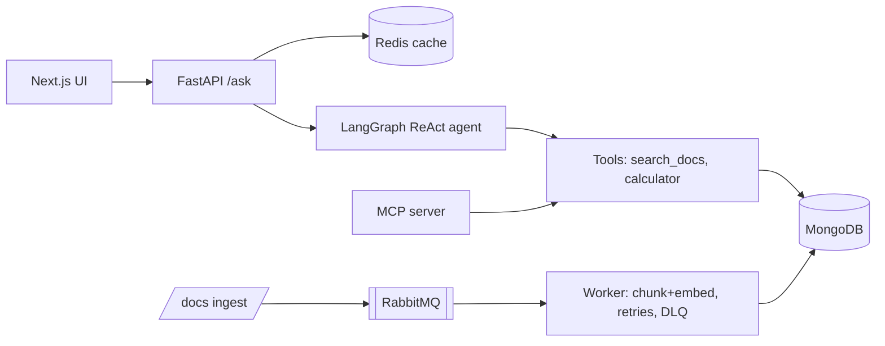
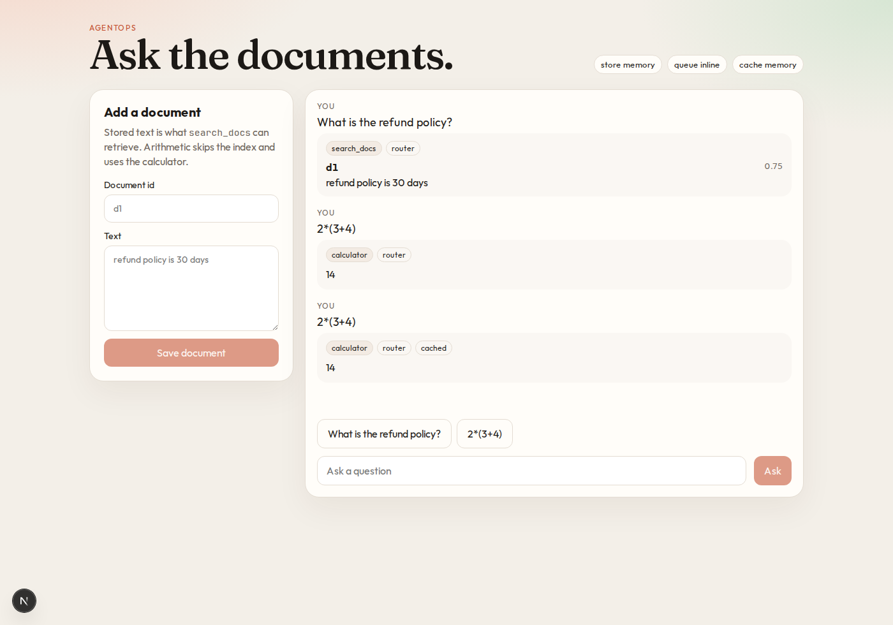
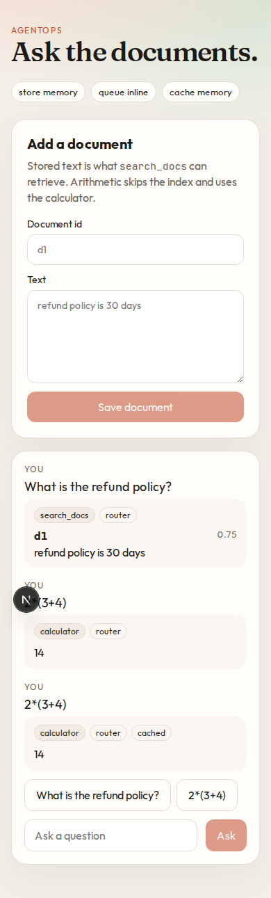

# AgentOps MCP

[](https://github.com/naveecode/agentops-mcp/actions)

A deployable AI agent service. A LangGraph ReAct agent answers questions over your documents and calls tools. The same tools are exposed as an **MCP server**, so Cursor and Claude Desktop can use them. Documents are chunked, embedded, and stored in MongoDB. Ingest runs inline, or through a RabbitMQ worker that retries and then dead-letters.

## Problem
Teams want one agent that can answer from internal docs, run tools, and be reached two ways: over a REST API, and from AI IDEs over MCP. It should also be cached, testable, and deployable.

## Architecture

Built: API, LangGraph agent, MCP server, Redis cache, MongoDB document and chat store, RabbitMQ worker, eval harness, Next.js chat UI, Docker, Render, Fly, and kind manifests, CI.

## Quickstart
```bash
pip install -r requirements.txt
uvicorn app.main:app --reload          # http://localhost:8000/docs
docker compose up --build              # API, worker, Redis, MongoDB, RabbitMQ
pytest -q                              # offline tests
python -m app.evals                    # tool accuracy, golden Q&A, guardrails
python -m app.mcp_server               # MCP (stdio) for Cursor/Claude
cd web && npm install
API_URL=http://127.0.0.1:8000 npm run dev   # http://localhost:3000
```
Set `OPENAI_API_KEY` (and optionally `MODEL`, default `gpt-4o-mini`) to use the LangGraph ReAct agent. Without a key, a deterministic router picks the tool, so tests and demos run offline.

```bash
curl -XPOST localhost:8000/docs -H 'content-type: application/json' -d '{"id":"d1","text":"refund policy is 30 days"}'
curl -XPOST localhost:8000/ask  -H 'content-type: application/json' -d '{"question":"refund policy"}'
curl localhost:8000/chats
```

Point Cursor or Claude Desktop at the MCP server:

```json
{ "mcpServers": { "agentops": { "command": "python", "args": ["-m", "app.mcp_server"] } } }
```

## Environment
| Variable | Role |
| --- | --- |
| `OPENAI_API_KEY` | Turns on the LangGraph agent. Unset uses the offline router. |
| `MODEL` | Chat model name. Default `gpt-4o-mini`. |
| `REDIS_URL` | Shared ask-cache. Unset uses process memory. |
| `MONGO_URL` | Document chunks and chat turns. Unset uses memory. |
| `MONGO_DB` | Database name. Default `agentops`. |
| `MONGO_VECTOR_INDEX` | Atlas `$vectorSearch` index on `chunks.embedding`. |
| `RABBITMQ_URL` | Publishes ingest to the worker. Unset ingests inline. |
| `API_URL` | Used by the Next.js server to reach the API. Default `http://127.0.0.1:8000`. |

## Ingest and search
`POST /docs` chunks the text and stores a hashed embedding with each chunk. Without `RABBITMQ_URL` that happens in the request. With it, the API publishes to the `ingest` queue and `python -m app.worker` does the write. A message is attempted three times. The next failure is published to `ingest.dlq`. The broker dead-letters rejected deliveries to that same queue, so a crash does not drop the message.

Search keeps chunks that share a query token and breaks ties with cosine similarity. When `MONGO_VECTOR_INDEX` is set, search tries Atlas `$vectorSearch` first and falls back to the local ranker if the index is unavailable. A new document clears cached `ask:` answers. Across the API and the worker, that invalidation needs Redis.

Guardrails run before any tool. Empty input, questions over 2,000 characters, and prompt-injection phrasing are refused.

## Chat UI
The Next.js app in [`web/`](web/) stores a document, asks the agent, and shows which tool answered. A repeat question is marked cached.



On a narrow screen the document form stacks above the conversation.



The browser calls same-origin routes under `/api`. Those routes proxy to `API_URL`, so a Vercel deployment does not need browser CORS on the API.

## Deploy
`docker compose up --build` starts the API, the worker, the web UI, Redis, MongoDB, and RabbitMQ. The UI is on port 3000.

### Vercel
Import the repo and set the project root to `web`. Set `API_URL` to the public API, such as the Render or Fly URL. [`web/vercel.json`](web/vercel.json) selects the Next.js framework. The API stays on Render or Fly; Vercel only hosts the UI.

### Render and Fly

[render.yaml](render.yaml) is a Render blueprint: a web service on the image, plus a worker running `python -m app.worker`. Supply `OPENAI_API_KEY`, `REDIS_URL` (Upstash), `MONGO_URL` (Atlas), and `RABBITMQ_URL` (CloudAMQP). Set `MONGO_VECTOR_INDEX` when the Atlas index exists.

[fly.toml](fly.toml) runs the same image as an `app` process and a `worker` process. Rename `app` if it is taken, then:

```bash
fly secrets set OPENAI_API_KEY=... REDIS_URL=... MONGO_URL=... RABBITMQ_URL=...
fly deploy
```

CI builds the API image and checks `/health`, a document ingest, and `/ask`. It also builds the Next.js app and renders the Kubernetes manifests with `kubectl kustomize`.

### Kubernetes
Manifests in [`k8s/`](k8s/) run Redis, MongoDB, RabbitMQ, the API, the ingest worker, and the web UI in the `agentops` namespace. Services are headless, so in-cluster DNS returns pod addresses. The API and web images are `agentops-mcp:local` and `agentops-web:local` with `imagePullPolicy: IfNotPresent`, which matches a kind cluster after `kind load`.

[`scripts/kind-smoke.sh`](scripts/kind-smoke.sh) creates a cluster, loads those images plus Redis, MongoDB, and RabbitMQ, waits for rollouts, and checks that a stored document is searchable and that `2*(3+4)` returns 14 through the web proxy.

```bash
./scripts/kind-smoke.sh
```

## Roadmap
- [x] MVP: FastAPI, LangGraph agent, MCP server, Redis cache, Docker, CI
- [x] MongoDB document and chat store, with vector search
- [x] RabbitMQ ingest worker with retries and a dead-letter queue
- [x] Eval harness (tool-call accuracy, golden Q&A) and guardrails
- [x] Next.js (TypeScript) chat UI, deployable to Vercel
- [x] Deploy config: Render, Fly, and Vercel
- [x] Kubernetes manifests, tested on kind
